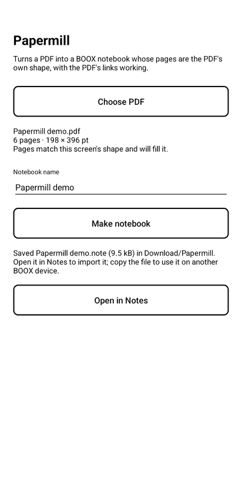
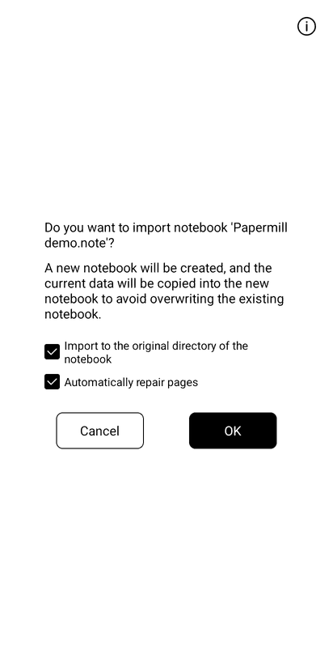
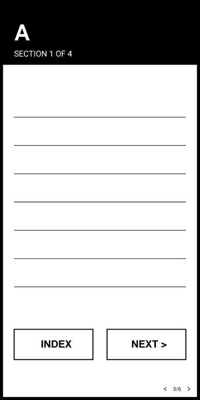

# Aragonite Papermill

Turns a PDF into a BOOX Notes notebook whose pages are the PDF's own shape, with the
PDF's links working.

BOOX Notes can already bring a PDF in two ways, and each gives something up:

- **Create → From Local File** keeps the PDF's links, but stores every page as A4. A page
  that isn't A4-shaped is boxed inside A4, and A4 is then boxed inside the screen. A PDF
  made for a 1:2 Palma screen ends up at 71% size with margins on all four sides.
- **Page + → From Files** keeps the page shape, but copies the pages into a new PDF and
  drops every link that points forward in the document.

Papermill writes a `.note` file that has the right page shape *and* points at the
unmodified PDF, then hands it to Notes' own import screen.

## Use

1. Open Papermill and choose a PDF, or open/share a PDF to Papermill from a file manager.
2. Check the notebook name and tap **Make notebook**. The file is saved in
   `Download/Papermill`.
3. Tap **Open in Notes**. Notes asks whether to import the notebook; say OK.

The notebook appears at the top level of Notes, named after the file (Notes may add a
number, as in "Address Book(1)"). To put the same notebook on another BOOX device, copy the
`.note` file there and tap it in the file manager.

| Papermill | Notes' import prompt | The notebook |
|---|---|---|
|  |  |  |

Taken on a Palma 2 Pro with the sample PDF in `docs/sample/`, whose pages have a border at
the very edge. `python3 tools/make_sample.py` rebuilds it.

## Which devices need it

The A4 behaviour depends on the Notes version. Importing the same 1:2 PDF with Notes' own
"From Local File":

| Notes | Firmware | Device | Page size Notes stored | Result |
|---|---|---|---|---|
| 45960 | 4.2 | Palma 2 Pro | 2100×4200, the PDF's shape | Full bleed already |
| 46343 | 4.3.1 | Palma 3 | 2100×2970, A4 | Letterboxed to 71% |

So Papermill matters on newer Notes. On 45960 it produces the same result as the built-in
import. Notes 46258 (firmware 4.3) has not been checked either way.

## What it does and doesn't do

- Each notebook page is the PDF page fitted inside Notes' A4 box and cropped to the page,
  which keeps the page units a stock PDF import uses.
- The PDF is embedded byte for byte. Its links are ordinary PDF links; nothing is rewritten.
- The file carries no account, library or device identifiers. Notes issues its own notebook
  and page ids on import.
- There is no writable margin around the page. A stock import leaves blank space beside a
  page that is narrower than the screen; these pages end at the PDF's edge.
- The zoom a notebook first opens at is set for the screen it was made on. On a different
  screen the first page may open at the wrong zoom until you turn a page.
- Password-protected PDFs are refused (Notes can't open them either).

## Tested

| Device | Firmware | Notes | Result |
|---|---|---|---|
| Palma 3 (824×1648) | 4.3.1 | 46343 | Desktop-built file: full bleed, forward and backward links work, survives close and reopen |
| Note Mini C (1536×2048) | 4.3 | 46258 | App-built file: fills the height, links work |
| Palma 2 Pro (824×1648) | 4.2 | 45960 | App-built file: full bleed on first open, forward and backward links work |

Not yet tested: pen strokes staying aligned across a close and reopen, rotated or cropped
PDF pages, landscape pages, PDFs with mixed page sizes, and behaviour over a long sync.

## How it works

[docs/note-format.md](docs/note-format.md) describes the parts of the `.note` format this
relies on and how they were established.

`tools/pdf2note.py` is the desktop reference implementation (Python, needs `pypdf`):

```
python3 tools/pdf2note.py input.pdf [-o output.note] [--title T] [--screen WxH]
```

## Build

Android Studio is optional; a JDK 17 and the Android SDK are enough.

```
./gradlew :app:testDebugUnitTest :app:assembleDebug :app:lintDebug
```

The debug APK is under `app/build/outputs/apk/debug/`.

The icon reuses the Aragonite family's crystal master from
[Aragonite PowerSync](https://github.com/jdkruzr/AragonitePowerSync/tree/main/design/icons).
The source artwork and the editable sheet symbol are in `design/icons/`. Run
`python3 design/icons/export.py` (needs Pillow and `rsvg-convert`) to rebuild the launcher
icons.

## Licence

Apache-2.0. PDF parsing uses [PdfBox-Android](https://github.com/TomRoush/PdfBox-Android)
(Apache-2.0).
